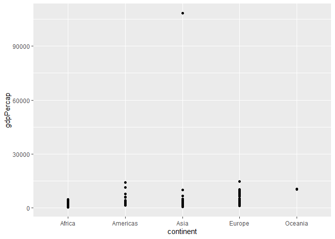
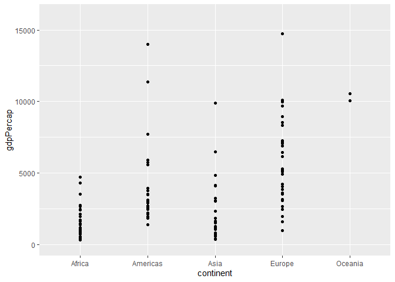
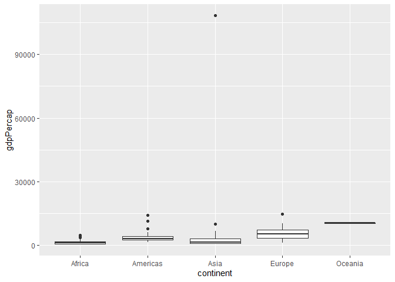
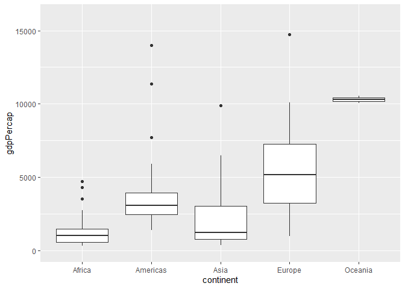
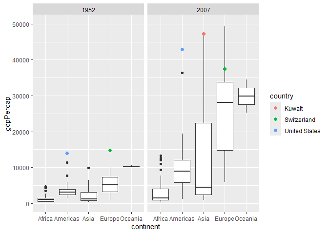
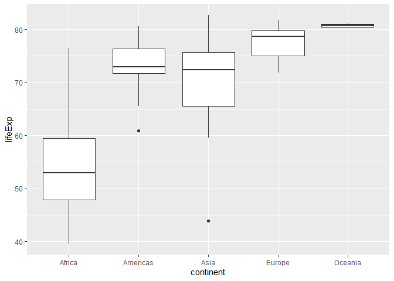
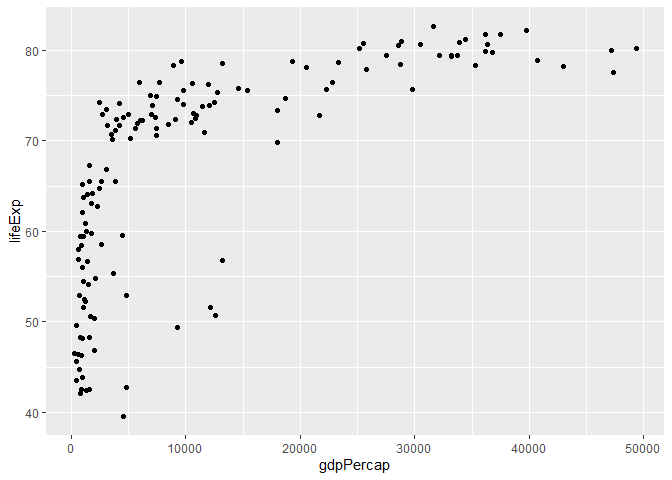
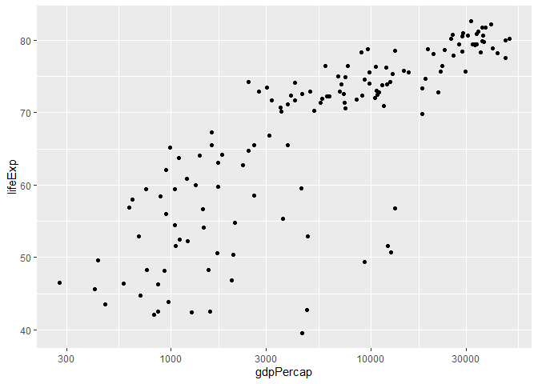
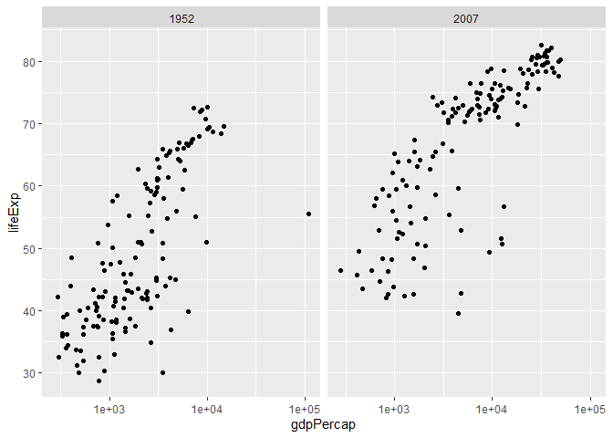

Gapminder
================
Lea
9-28-2026

- [Grading Rubric](#grading-rubric)
  - [Individual](#individual)
  - [Submission](#submission)
- [Guided EDA](#guided-eda)
  - [**q0** Perform your “first checks” on the dataset. What variables
    are in
    this](#q0-perform-your-first-checks-on-the-dataset-what-variables-are-in-this)
  - [**q1** Determine the most and least recent years in the `gapminder`
    dataset.](#q1-determine-the-most-and-least-recent-years-in-the-gapminder-dataset)
  - [**q2** Filter on years matching `year_min`, and make a plot of the
    GDP per capita against continent. Choose an appropriate `geom_` to
    visualize the data. What observations can you
    make?](#q2-filter-on-years-matching-year_min-and-make-a-plot-of-the-gdp-per-capita-against-continent-choose-an-appropriate-geom_-to-visualize-the-data-what-observations-can-you-make)
  - [**q3** You should have found *at least* three outliers in q2 (but
    possibly many more!). Identify those outliers (figure out which
    countries they
    are).](#q3-you-should-have-found-at-least-three-outliers-in-q2-but-possibly-many-more-identify-those-outliers-figure-out-which-countries-they-are)
  - [**q4** Create a plot similar to yours from q2 studying both
    `year_min` and `year_max`. Find a way to highlight the outliers from
    q3 on your plot *in a way that lets you identify which country is
    which*. Compare the patterns between `year_min` and
    `year_max`.](#q4-create-a-plot-similar-to-yours-from-q2-studying-both-year_min-and-year_max-find-a-way-to-highlight-the-outliers-from-q3-on-your-plot-in-a-way-that-lets-you-identify-which-country-is-which-compare-the-patterns-between-year_min-and-year_max)
- [Your Own EDA](#your-own-eda)
  - [**q5** Create *at least* three new figures below. With each figure,
    try to pose new questions about the
    data.](#q5-create-at-least-three-new-figures-below-with-each-figure-try-to-pose-new-questions-about-the-data)

*Purpose*: Learning to do EDA well takes practice! In this challenge
you’ll further practice EDA by first completing a guided exploration,
then by conducting your own investigation. This challenge will also give
you a chance to use the wide variety of visual tools we’ve been
learning.

<!-- include-rubric -->

# Grading Rubric

<!-- -------------------------------------------------- -->

Unlike exercises, **challenges will be graded**. The following rubrics
define how you will be graded, both on an individual and team basis.

## Individual

<!-- ------------------------- -->

| Category | Needs Improvement | Satisfactory |
|----|----|----|
| Effort | Some task **q**’s left unattempted | All task **q**’s attempted |
| Observed | Did not document observations, or observations incorrect | Documented correct observations based on analysis |
| Supported | Some observations not clearly supported by analysis | All observations clearly supported by analysis (table, graph, etc.) |
| Assessed | Observations include claims not supported by the data, or reflect a level of certainty not warranted by the data | Observations are appropriately qualified by the quality & relevance of the data and (in)conclusiveness of the support |
| Specified | Uses the phrase “more data are necessary” without clarification | Any statement that “more data are necessary” specifies which *specific* data are needed to answer what *specific* question |
| Code Styled | Violations of the [style guide](https://style.tidyverse.org/) hinder readability | Code sufficiently close to the [style guide](https://style.tidyverse.org/) |

## Submission

<!-- ------------------------- -->

Make sure to commit both the challenge report (`report.md` file) and
supporting files (`report_files/` folder) when you are done! Then submit
a link to Canvas. **Your Challenge submission is not complete without
all files uploaded to GitHub.**

``` r
library(tidyverse)
```

    ## ── Attaching core tidyverse packages ──────────────────────── tidyverse 2.0.0 ──
    ## ✔ dplyr     1.2.1     ✔ readr     2.2.0
    ## ✔ forcats   1.0.1     ✔ stringr   1.6.0
    ## ✔ ggplot2   4.0.3     ✔ tibble    3.3.1
    ## ✔ lubridate 1.9.5     ✔ tidyr     1.3.2
    ## ✔ purrr     1.2.2     
    ## ── Conflicts ────────────────────────────────────────── tidyverse_conflicts() ──
    ## ✖ dplyr::filter() masks stats::filter()
    ## ✖ dplyr::lag()    masks stats::lag()
    ## ℹ Use the conflicted package (<http://conflicted.r-lib.org/>) to force all conflicts to become errors

``` r
library(gapminder)
```

*Background*: [Gapminder](https://www.gapminder.org/about-gapminder/) is
an independent organization that seeks to educate people about the state
of the world. They seek to counteract the worldview constructed by a
hype-driven media cycle, and promote a “fact-based worldview” by
focusing on data. The dataset we’ll study in this challenge is from
Gapminder.

# Guided EDA

<!-- -------------------------------------------------- -->

First, we’ll go through a round of *guided EDA*. Try to pay attention to
the high-level process we’re going through—after this guided round
you’ll be responsible for doing another cycle of EDA on your own!

### **q0** Perform your “first checks” on the dataset. What variables are in this

dataset?

``` r
## TASK: Do your "first checks" here!
gapminder
```

    ## # A tibble: 1,704 × 6
    ##    country     continent  year lifeExp      pop gdpPercap
    ##    <fct>       <fct>     <int>   <dbl>    <int>     <dbl>
    ##  1 Afghanistan Asia       1952    28.8  8425333      779.
    ##  2 Afghanistan Asia       1957    30.3  9240934      821.
    ##  3 Afghanistan Asia       1962    32.0 10267083      853.
    ##  4 Afghanistan Asia       1967    34.0 11537966      836.
    ##  5 Afghanistan Asia       1972    36.1 13079460      740.
    ##  6 Afghanistan Asia       1977    38.4 14880372      786.
    ##  7 Afghanistan Asia       1982    39.9 12881816      978.
    ##  8 Afghanistan Asia       1987    40.8 13867957      852.
    ##  9 Afghanistan Asia       1992    41.7 16317921      649.
    ## 10 Afghanistan Asia       1997    41.8 22227415      635.
    ## # ℹ 1,694 more rows

**Observations**:

- The variables are country, continent, year, lifeExp (presumably life
  expectancy), pop (presumably population), and gdpPercap (presumably
  GDP per capita)

### **q1** Determine the most and least recent years in the `gapminder` dataset.

*Hint*: Use the `pull()` function to get a vector out of a tibble.
(Rather than the `$` notation of base R.)

``` r
## TASK: Find the largest and smallest values of `year` in `gapminder`
year_min <- gapminder |> 
  pull(year) |>
  min()

year_max <- gapminder |> 
  pull(year) |> 
  max()

year_min
```

    ## [1] 1952

``` r
year_max
```

    ## [1] 2007

Use the following test to check your work.

``` r
## NOTE: No need to change this
assertthat::assert_that(year_max %% 7 == 5)
```

    ## [1] TRUE

``` r
assertthat::assert_that(year_max %% 3 == 0)
```

    ## [1] TRUE

``` r
assertthat::assert_that(year_min %% 7 == 6)
```

    ## [1] TRUE

``` r
assertthat::assert_that(year_min %% 3 == 2)
```

    ## [1] TRUE

``` r
if (is_tibble(year_max)) {
  print("year_max is a tibble; try using `pull()` to get a vector")
  assertthat::assert_that(False)
}

print("Nice!")
```

    ## [1] "Nice!"

### **q2** Filter on years matching `year_min`, and make a plot of the GDP per capita against continent. Choose an appropriate `geom_` to visualize the data. What observations can you make?

You may encounter difficulties in visualizing these data; if so document
your challenges and attempt to produce the most informative visual you
can.

``` r
## TASK: Create a visual of gdpPercap vs continent
filtered_years <- gapminder |>
  filter(year == year_min)

filtered_years |>
  ggplot() +
  geom_point(
    mapping = aes(
      x = continent,
      y = gdpPercap
    )
  )
```

<!-- -->

``` r
filtered_years |>
  ggplot() +
  geom_point(
    mapping = aes(
      x = continent,
      y = gdpPercap
    )
  ) + 
  coord_cartesian(ylim = c(0, 16000))
```

<!-- -->

``` r
filtered_years |>
  ggplot() +
  geom_boxplot(
    aes(
      x = continent,
      y = gdpPercap
    )
  )
```

<!-- -->

``` r
filtered_years |>
  ggplot() +
  geom_boxplot(
    aes(
      x = continent,
      y = gdpPercap
    )
  ) + 
  coord_cartesian(ylim = c(0, 16000))
```

<!-- -->

**Observations**:

- Oceania has the highest median GDP per capita, but it’s not a very
  fair comparison because there are only 2 data points (as opposed to
  the others, which have many more)
- Of the other 4, Europe has the highest median GDP per capita, but with
  a much larger interquartile range than the others. However, even its
  first quartile is above any of the other continents’ medians.
- The Americas have the next highest median, but they also have the
  highest and most spread out outliers (not counting Asia’s unusually
  large one)
- Asia and Africa’s medians are pretty close together, but Asia has
  higher outliers and 3rd quartile

**Difficulties & Approaches**:

- When first plotting all the data, there is a very distinct outlier
  thousands of dollars away from any of the others. Because the y-axis
  needs to account for the whole range, the scale is thrown off and all
  other data points are compressed into a very small section.
- To combat that issue, I used coord_cartesian() to zoom in on the rest
  of the data but not delete the outlier.
- When replotting with the y-axis zoomed in, I realized that a
  scatterplot probably wasn’t the right choice because I couldn’t
  clearly compare the centers and spreads of the distributions, so I
  decided to try a box plot instead.

### **q3** You should have found *at least* three outliers in q2 (but possibly many more!). Identify those outliers (figure out which countries they are).

``` r
## TASK: Identify the outliers from q2
outliers <- filtered_years |>
  filter(gdpPercap > 12000)

outliers
```

    ## # A tibble: 3 × 6
    ##   country       continent  year lifeExp       pop gdpPercap
    ##   <fct>         <fct>     <int>   <dbl>     <int>     <dbl>
    ## 1 Kuwait        Asia       1952    55.6    160000   108382.
    ## 2 Switzerland   Europe     1952    69.6   4815000    14734.
    ## 3 United States Americas   1952    68.4 157553000    13990.

**Observations**:

- Identify the outlier countries from q2
  - Kuwait was the extra far outlier, and the other 2 highest were
    Switzerland and the United States.

*Hint*: For the next task, it’s helpful to know a ggplot trick we’ll
learn in an upcoming exercise: You can use the `data` argument inside
any `geom_*` to modify the data that will be plotted *by that geom
only*. For instance, you can use this trick to filter a set of points to
label:

``` r
## NOTE: No need to edit, use ideas from this in q4 below
gapminder %>%
  filter(year == max(year)) %>%

  ggplot(aes(continent, lifeExp)) +
  geom_boxplot() +
  geom_point(
    data = . %>% filter(country %in% c("United Kingdom", "Japan", "Zambia")),
    mapping = aes(color = country),
    size = 2
  )
```

<!-- -->

### **q4** Create a plot similar to yours from q2 studying both `year_min` and `year_max`. Find a way to highlight the outliers from q3 on your plot *in a way that lets you identify which country is which*. Compare the patterns between `year_min` and `year_max`.

*Hint*: We’ve learned a lot of different ways to show multiple
variables; think about using different aesthetics or facets.

``` r
## TASK: Create a visual of gdpPercap vs continent
years_filtered <- gapminder |>
  filter(year %in% c(year_min, year_max))

outliers <- years_filtered |>
  filter(
    country %in% c("Kuwait", "Switzerland", "United States")
  )

years_filtered |>
  ggplot(
    aes(
      x = continent,
      y = gdpPercap
    )
  ) +
  geom_boxplot() +
  geom_point(
    data = outliers,
    mapping = aes(color = country),
    size = 2
  ) +
  facet_wrap(~ year) +
  coord_cartesian(ylim = c(0, 50000))
```

<!-- -->

**Observations**:

- Median GDP per capita increased on every continent from 1952 to 2007.
- In 2007, all continents had a much wider spread, with their
  interquartile ranges all being much longer than those in the previous
  graph.
- Oceania has a much wider spread than before, but its median GDP per
  capita remains the highest of all the continents.
- Europe is still the second highest, with its median falling much
  closer to Oceania’s than any other continent.
- Kuwait gets much closer to all the other Asian countries, but remains
  the highest. The United States remains the highest in the Americas as
  well. Switzerland, however, was no longer the highest in Europe, but
  it did stay on the higher end of the distribution.
- Asia’s range increased greatly, with the highest values extending as
  far up as Europe’s highest. The two of them have some of the highest
  GDPs per capita of all the countries, as well as the longest
  interquartile ranges, showing much more spread over the years.

# Your Own EDA

<!-- -------------------------------------------------- -->

Now it’s your turn! We just went through guided EDA considering the GDP
per capita at two time points. You can continue looking at outliers,
consider different years, repeat the exercise with `lifeExp`, consider
the relationship between variables, or something else entirely.

### **q5** Create *at least* three new figures below. With each figure, try to pose new questions about the data.

``` r
## TASK: Your first graph
gapminder |>
  filter(year == year_max) |>
  ggplot(
    aes(
      x = continent,
      y = lifeExp
    )
  ) +
  geom_boxplot()
```

<!-- -->

- This plot is investigating how life expectancy differs across
  continents in the most recent year recorded
- Oceania has the highest median of all the continents, and all of its
  values fall in a fairly small range
- Europe has the second highest median, with a longer interquartile
  range than Oceania. Its interquartile range is similar to the
  Americas, although the spread falls in different directions between
  them.
- The Americas and Asia have very similar medians, but Asia’s countries
  range much further.
- Africa has the lowest median by a fairly significant amount, but also
  has the longest range of all continents.

``` r
## TASK: Your second graph
gapminder |>
  filter(year == year_max) |>
  ggplot(
    aes(
      x = gdpPercap,
      y = lifeExp
    )
  ) +
  geom_point()
```

<!-- -->

``` r
gapminder |>
  filter(year == year_max) |>
  ggplot(
    aes(
      x = gdpPercap,
      y = lifeExp
    )
  ) +
  geom_point() +
  scale_x_log10()
```

<!-- -->

- This plot is investigating how life expectancies vary across different
  GDP per capitas.
- Because the GDPs are so skewed to the left, I plotted it with a
  logarithmic x-axis to make it more readable and the relationship more
  clear.
- Higher GDP per capita is generally associated with higher life
  expectancy.

``` r
## TASK: Your third graph
gapminder |>
  filter(year %in% c(year_min, year_max)) |>
  ggplot(
    aes(
      x = gdpPercap,
      y = lifeExp
    )
  ) +
  geom_point() +
  scale_x_log10() +
  facet_wrap(~ year)
```

<!-- -->

- This plot is investigating how that relationship between life
  expectance and GDP per capita has changed over time.
- The relationship appeared less tightly grouped in 1952, especially
  with the countries with lower GDP per capita.
- In 2007, life expectancy generally increases with GDP per capita, but
  the relationship seems to level off a bit at the higher values.
